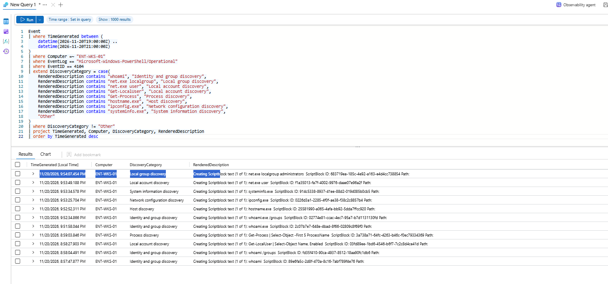

# Scenario 01: PowerShell execution and discovery

[Overview](../project-overview.md) · [Next: Scenario 02 →](02-registry-runkey-persistence.md)

## Objective

Validate PowerShell Script Block Logging and investigate discovery activity commonly relevant during early-stage endpoint triage.

## Telemetry

- Provider/channel: `Microsoft-Windows-PowerShell/Operational`
- Event ID: `4104`
- Workspace table: `Event`
- Endpoint: `ENT-WKS-01`

## Controlled activity

The lab generated benign discovery commands, including:

- `whoami.exe`
- `whoami.exe /groups`
- `hostname.exe`
- `ipconfig.exe`
- `systeminfo.exe`
- `net.exe user`
- `net.exe localgroup administrators`

These commands were used to validate logging and detection of account, host, network and system discovery. They are not evidence of an intrusion.

## Investigation

The 4104 script-block records were queried in Sentinel and reviewed for command content and endpoint context. The validated reference query is [`detections/powershell-discovery.kql`](../../detections/powershell-discovery.kql). A categorised version that labels each record, as shown in Figure 1, is [`detections/powershell-discovery-categorised.kql`](../../detections/powershell-discovery-categorised.kql); it was validated against the Scenario 01 test window and uses a fixed UTC window of 19:00–21:00 on 20 November 2026.

## Result

PowerShell script-block telemetry was observed for the controlled commands, and the discovery detection was validated.

*Figure 1. Script-block records (Event ID 4104) on `ENT-WKS-01`, labelled with a discovery category (11 records). The `TimeGenerated` column is displayed in Nigeria local time (UTC+01:00), one hour ahead of the raw UTC values (for example, 9:54 PM local is 8:54 PM UTC). The results include the PowerShell-native equivalents `Get-LocalUser` and `Get-Process` and the plain `whoami` / `whoami /groups` forms (7:57–7:59 PM UTC), followed by the `.exe` command forms listed above (8:51–8:54 PM UTC).*

## Analyst interpretation

Discovery commands are dual-use. They may be run by administrators, support staff, scripts or an attacker. The command sequence and surrounding activity should be considered before escalating an alert.

## Evidence and cleanup

No persistent test artefact was created for this scenario.

[Overview](../project-overview.md) · [Next: Scenario 02 →](02-registry-runkey-persistence.md)
