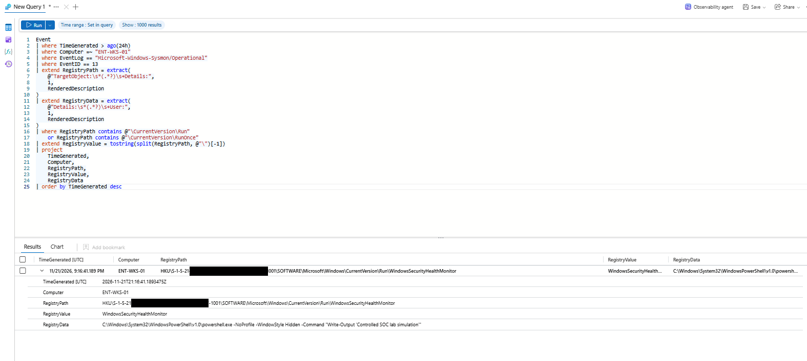

# Scenario 02: Registry Run Key persistence

[← Previous: Scenario 01](01-powershell-execution-and-discovery.md) · [Overview](../project-overview.md) · [Next: Scenario 03 →](03-scheduled-task-persistence.md)

## Objective

Generate and detect a controlled registry value modification in a common Windows auto-start location.

## Telemetry

- Provider/channel: `Microsoft-Windows-Sysmon/Operational`
- Event ID: `13` (Registry value set)
- Workspace table: `Event`
- Endpoint: `ENT-WKS-01`

## Controlled activity

A value named `WindowsSecurityHealthMonitor` was created under:

`HKCU\Software\Microsoft\Windows\CurrentVersion\Run`

The stored command was a harmless PowerShell command that wrote a controlled lab message. It was not executed as part of the test; the aim was to create registry telemetry only.

## Detection

The Sysmon Event ID 13 record was ingested into Sentinel. The KQL query extracts the registry path and data, derives the value name, and filters for Run and RunOnce locations.

Query: [`detections/registry-runkey-persistence.kql`](../../detections/registry-runkey-persistence.kql)

## Result

The detection query returned the controlled registry modification, showing the endpoint, registry path, value name and the stored command. The underlying Sysmon record also carries process and user context. The test value was removed after evidence capture.

*Figure 1. Sysmon Event ID 13 result for the `WindowsSecurityHealthMonitor` value. The `TimeGenerated` column is displayed in UTC. The user SID inside the registry path is redacted.*

## Analyst interpretation

A Run Key value can be used for persistence, but not every value in this location is malicious. Validate the executable path, signer, command line, user context, creation time and business legitimacy before concluding malicious persistence.

## Cleanup

The temporary `WindowsSecurityHealthMonitor` value was removed. The test did not require a reboot or execution of the stored command.

[← Previous: Scenario 01](01-powershell-execution-and-discovery.md) · [Overview](../project-overview.md) · [Next: Scenario 03 →](03-scheduled-task-persistence.md)
