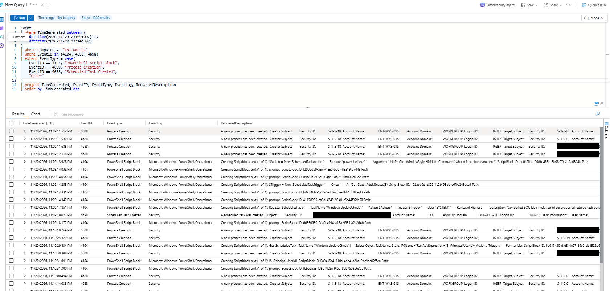

# Scenario 03: Scheduled Task persistence (`WindowsUpdateCheckSimulation`)

[← Previous: Scenario 02](02-registry-runkey-persistence.md) · [Overview](../project-overview.md) · [Next: Scenario 04 →](04-outbound-network-investigation.md)

**Contents:** [Simulation](#controlled-simulation) · [Telemetry](#telemetry) · [Timeline](#timeline) · [Result](#result) · [Attribution limitation](#attribution-limitation) · [Cleanup](#cleanup)

## Objective

Investigate scheduled-task creation and execution using Windows Security and PowerShell telemetry.

## Controlled simulation

The scenario is named `WindowsUpdateCheckSimulation`. The task created during the test was named `WindowsUpdateCheck`.

Task characteristics:

- Run-as account: `SYSTEM`
- Trigger: one-time trigger
- Action: `powershell.exe`
- Arguments: `-NoProfile -WindowStyle Hidden -Command "whoami.exe; hostname.exe"`
- Description: controlled SOC lab simulation of suspicious scheduled task persistence

The command was intentionally harmless. It did not download files, exfiltrate data or modify security settings.

## Telemetry

- Security Event ID `4698`: scheduled task created
- Security Event ID `4688`: process creation
- PowerShell Event ID `4104`: script-block activity

All records were queried from the `Event` table for `ENT-WKS-01`.

## Timeline

The task was registered on 20 November 2026 at approximately 23:09 UTC. Its one-time execution occurred at approximately 23:14 UTC on the same date (shown in the portal's local-time display as shortly after midnight on 21 November). Process-creation (4688) records at about 23:13–23:14 UTC provide execution-related evidence.

The consolidated timeline query is [`detections/scheduled-task-correlation.kql`](../../detections/scheduled-task-correlation.kql). It uses a fixed UTC window (23:09:00 to 23:14:30 on 20 November 2026).

## Result

Task creation and execution evidence was observed and correlated across the three event types.

*Figure 1. Timeline of Events 4104, 4688 and 4698 on `ENT-WKS-01`, ordered oldest first. The `TimeGenerated` column is displayed in UTC. The 4104 records show the task action, trigger and `Register-ScheduledTask` call for `WindowsUpdateCheck`; the 4698 record appears at 11:09:18 PM UTC. Security identifiers are redacted.*

## Attribution limitation

The task-creation event included client and parent process identifiers, but the available process-creation records did not establish a definitive matching creator process. This report therefore does not attribute task creation to a specific process.

## Cleanup

The `WindowsUpdateCheck` task was removed after evidence capture.

[← Previous: Scenario 02](02-registry-runkey-persistence.md) · [Overview](../project-overview.md) · [Next: Scenario 04 →](04-outbound-network-investigation.md)
