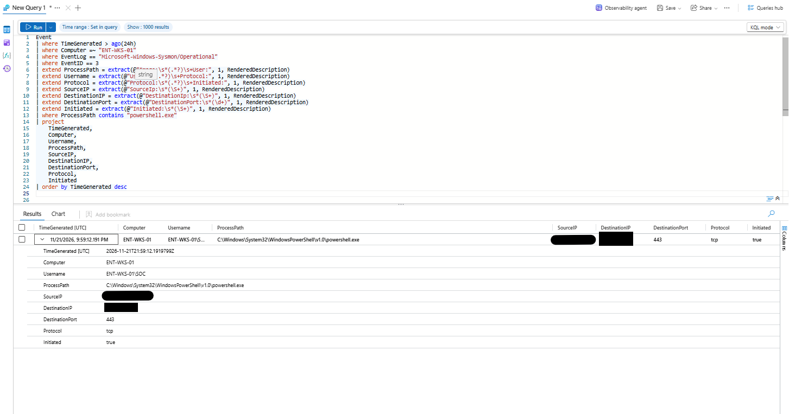

# Scenario 04: PowerShell outbound network activity

[← Previous: Scenario 03](03-scheduled-task-persistence.md) · [Overview](../project-overview.md) · [Next: Scenario 05 →](05-authentication-investigation.md)

## Objective

Validate Sysmon network-connection telemetry and investigate a PowerShell-initiated outbound connection.

## Telemetry

- Provider/channel: `Microsoft-Windows-Sysmon/Operational`
- Event ID: `3` (Network connection)
- Workspace table: `Event`
- Endpoint: `ENT-WKS-01`

## Controlled activity

The lab ran a connectivity test to `example.com` over TCP port 443 using PowerShell `Test-NetConnection`.

The test succeeded. It was a benign connectivity check, not malware traffic, command-and-control or evidence of compromise.

## Event details

The ingested Sysmon event identified:

- Process: `powershell.exe`
- User context: `ENT-WKS-01\SOC`
- Protocol: TCP
- Destination service: HTTPS, port 443
- Initiated: `true`

Source and destination IP addresses are redacted. The query output shows destination IP and port rather than a hostname, so the link to `example.com` comes from the operator's test record, not from a field in this result.

## Detection

The KQL query filters Sysmon Event ID 3 for PowerShell and extracts process path, username, protocol, source IP, destination IP, destination port and initiation status.

Query: [`detections/powershell-outbound-network.kql`](../../detections/powershell-outbound-network.kql)

## Result

The query returned the controlled PowerShell connection.

*Figure 1. Sysmon Event ID 3 record for `powershell.exe` on `ENT-WKS-01`, with the expanded row showing the extracted fields. The `TimeGenerated` column is displayed in UTC. Source and destination IPs are redacted.*

## Analyst interpretation

Sysmon Event ID 3 confirms that a network connection was recorded, not that it was malicious. An analyst should enrich destination reputation, DNS context, process lineage, frequency, destination prevalence and the user's expected activity before classifying a connection as suspicious.

## Cleanup

No persistent artefact was created by the connectivity test.

[← Previous: Scenario 03](03-scheduled-task-persistence.md) · [Overview](../project-overview.md) · [Next: Scenario 05 →](05-authentication-investigation.md)
