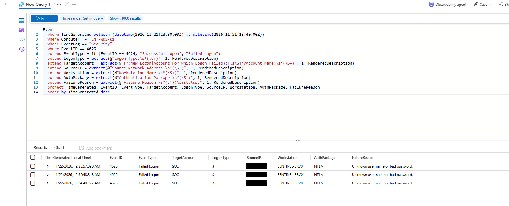
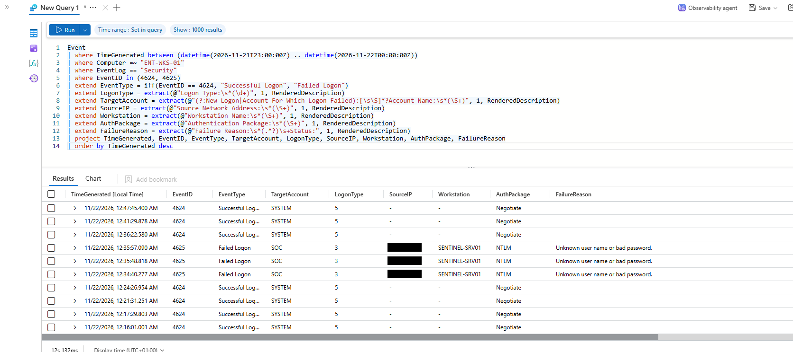

# Scenario 05: Authentication investigation

[← Previous: Scenario 04](04-outbound-network-investigation.md) · [Overview](../project-overview.md)

**Contents:** [Telemetry](#telemetry) · [Observations](#observations) · [Controlled SMB test](#controlled-remote-smb-test) · [Consolidated investigation](#consolidated-investigation) · [Results](#results) · [Interpretation](#analyst-interpretation)

## Objective

Investigate successful and failed Windows logons and validate remote network authentication failure telemetry.

## Telemetry

- Security Event ID `4624`: successful logon
- Security Event ID `4625`: failed logon
- Workspace table: `Event`
- Primary endpoint: `ENT-WKS-01`
- Supporting host: `SENTINEL-SRV01`

## Observations

The consolidated results (Figure 2) show successful logons for the `SYSTEM` account (logon type 5, service logons, Negotiate authentication, with no source address or workstation recorded) alongside three failed network logons for the `SOC` account. The fields reviewed were event type, target account, logon type, source address, workstation, authentication package and failure reason.

## Controlled remote SMB test

The supporting server initiated a connection to the endpoint's SMB service. Port 445 connectivity was confirmed. The following command was run on the supporting server:

```powershell
net use \\192.168.x.x\IPC$ /user:ENT-WKS-01\SOC *
```

An intentionally incorrect password was entered on three attempts. Windows returned error 1326, indicating that the username or password was incorrect.

The endpoint recorded three Security Event ID 4625 failures with:

- Target account: `SOC` on `ENT-WKS-01`
- Logon type: `3` (Network)
- Workstation name: `SENTINEL-SRV01`
- Logon process: `NtLmSsp`
- Authentication package: `NTLM`
- Failure status: `0xC000006D`
- Substatus: `0xC000006A` (incorrect password)

The source network address is the value recorded by Windows. It differed from the supporting server's configured interface address, consistent with virtual network address translation. The recorded value is reported as observed and is redacted in the screenshots.

## Consolidated investigation

The final KQL query combines successful and failed logons and extracts:

- Event type
- Target account
- Logon type
- Source IP
- Workstation
- Authentication package
- Failure reason

Query: [`detections/authentication-investigation.kql`](../../detections/authentication-investigation.kql)

A fixed-window version of the consolidated query, [`detections/authentication-investigation-window.kql`](../../detections/authentication-investigation-window.kql), covers 23:00 on 21 November to 00:00 on 22 November 2026 UTC and produced Figure 2. The three controlled failures are also isolated by [`detections/remote-smb-failed-logons.kql`](../../detections/remote-smb-failed-logons.kql), which applies the same extraction to 4625 events in a fixed UTC window (23:30–23:40 on 21 November 2026).

## Results

The consolidated query was validated. Both screenshots below display time in Nigeria local time (UTC+01:00); the underlying `TimeGenerated` values are UTC, so the three failures at 12:34–12:35 AM on 22 November appear as 23:34–23:35 UTC on 21 November in raw data.



*Figure 1. Three Event ID 4625 failures for target account `SOC` (logon type 3, NTLM) from workstation `SENTINEL-SRV01`, each with the failure reason "Unknown user name or bad password." The source address recorded by Windows is redacted.*



*Figure 2. Consolidated 4624/4625 timeline: successful `SYSTEM` logons (type 5, Negotiate, with no source address or workstation recorded) alongside the three failed logons for target account `SOC` (type 3, NTLM, workstation `SENTINEL-SRV01`). Source addresses are redacted.*

## Analyst interpretation

A failed logon is not automatically malicious. Consider the target account, logon type, source address, workstation, authentication package, failure status, event frequency and surrounding successful logons. In this scenario the three SMB failures were deliberately generated by the lab operator and are labelled as controlled test activity.

## Outcome

Security Event IDs 4624 and 4625 were collected and the consolidated investigation query was validated.

[← Previous: Scenario 04](04-outbound-network-investigation.md) · [Overview](../project-overview.md)
